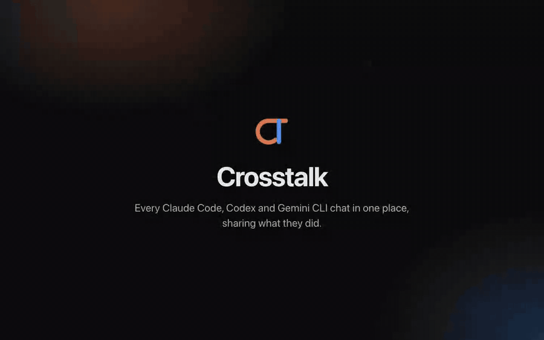
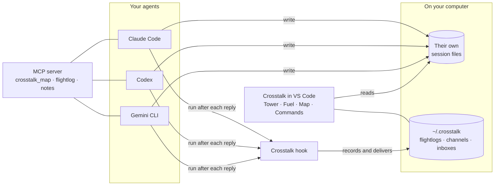
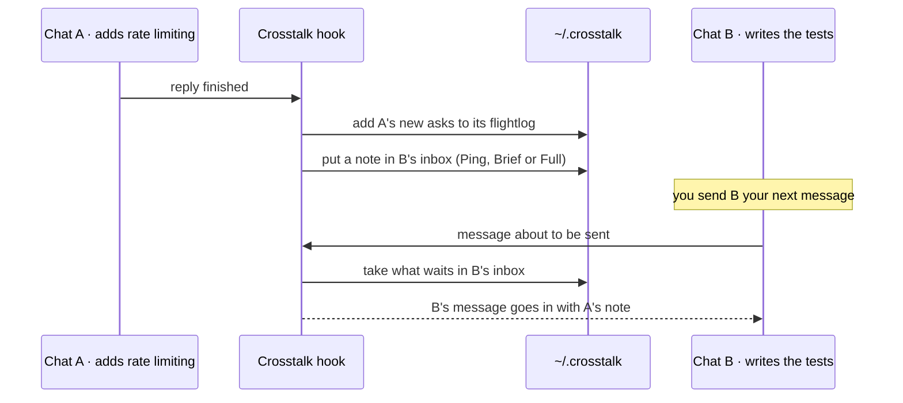

<p align="center">
  
</p>

<h1 align="center">Crosstalk</h1>

<p align="center">
  <strong>Every Claude Code, Codex and Gemini CLI chat in one place, sharing what they did.</strong>
</p>

<p align="center">
  <a href="https://github.com/HarshBaldaniya/crosstalk/actions/workflows/test.yml"></a>
  <a href="LICENSE"></a>
  
  
</p>

<p align="center">
  <a href="#install">Install</a> ·
  <a href="#features">Features</a> ·
  <a href="#how-it-works">How it works</a> ·
  <a href="#configuration">Configuration</a> ·
  <a href="#your-data-and-privacy">Privacy</a> ·
  <a href="#troubleshooting">Troubleshooting</a> ·
  <a href="#faq">FAQ</a>
</p>

<p align="center">
  
  <br>
  <sub>40 seconds, no sound. <a href="docs/media/crosstalk-demo.mp4">Watch the full-quality video</a>.</sub>
</p>

---

## Why Crosstalk

You run several AI coding chats at once: one adds a feature, another writes its tests, a third
reviews the pull request. Each starts blind to what the others just did, so you copy and paste
between them, or explain the same thing three times.

Crosstalk is a VS Code extension that puts every chat on one board and lets you **connect** them.
When a chat finishes a reply, each chat connected to it receives a short note with its next message:
what was asked, what was done and which files changed.

- **One place for every agent.** Claude Code, Codex and Gemini CLI chats side by side, live.
- **Chats that keep each other informed**, at the level of detail you choose.
- **Local by design.** It reads the session files your agents already keep. It runs no AI model of
  its own, sends nothing anywhere and never reads a login.

## Features

### Tower: every chat on one board


- Each chat is a card: its status, model, how full its context is, and who it shares with.
- **Connect** two chats by dragging one card onto the other. Click the line between them to choose
  how much it sends, make it two-way, pause it or close it:

  | Level | What the other chat receives after each reply |
  |---|---|
  | **Ping** *(default)* | One line per ask |
  | **Brief** | What was asked, done and still open, with the files and pull requests |
  | **Full** | The words themselves |

- **Arrange** cards by channel, time, agent or folder. **New task** starts a fresh chat from an old
  one's record.

### Map: your code, as a board


- Every part of the project is a small galaxy of its files; parts of one folder sit together.
- Hover or click a part or file to see what it **uses** (blue) and what **uses it** (orange).
- **Find** any file or function and the board flies to it. Drag parts to arrange them; they stay put.
- Built by a parser on your computer (tree-sitter), for TypeScript, JavaScript, Python, Go, Rust, Java,
  C#, Ruby and PHP. It updates within a second of a save.

### Commands: ready-made for every agent


- Commands for planning, building, auditing, reviewing, pull requests, tests, specs, recall and more,
  grouped by what you want to do.
- The same command in every agent: `/crosstalk:review` in Claude Code, `/prompts:review` in Codex,
  `/review` in Gemini CLI. Pick an agent, click the line, paste.
- Add your own as Markdown files in `~/.crosstalk/library/`.

### Fuel: your plan limits


- How much of each agent's plan is used, as the agent itself reports it, and when it resets.
- Tokens per chat and per agent, today and in total. The plan cards at the foot of the sidebar open it.

### Agent tools

**Set up my agents** gives each agent three tools over MCP, under 400 tokens of definitions in total:

| Tool | What an agent can do with it |
|---|---|
| `crosstalk_map` | `find` code by name or meaning (ranked, with `path:start-end`), `outline` a file or folder, `graph` who uses what, `check` unused code and stale docs, or get an overview of the project |
| `crosstalk_flightlog` | Read another chat's asks and outcomes, or search every chat |
| `crosstalk_notes` | List, read and save notes chats leave for the project |

## How it works



When two chats are connected:



A **flightlog** is a short record of a chat: one line per ask, with what was done, the files, commits
and pull requests, and what is still open. It is never a copy of the conversation; the exact words
stay in the agent's own files.

## Install

Pick the way that fits how you work. They all install the same thing, and you can use more than one.

### One command, for every agent

```bash
npm create crosstalk
```

Use whichever package manager you already have. Each line does the same thing:

| Package manager | Set up (first time) | Run once, without installing | Install only the command |
|---|---|---|---|
| npm | `npm create crosstalk` | `npx crosstalk-ai` | `npm install --global crosstalk-ai` |
| pnpm | `pnpm create crosstalk` | `pnpm dlx crosstalk-ai` | `pnpm add --global crosstalk-ai` |
| Yarn | `yarn create crosstalk` | `yarn dlx crosstalk-ai` | `yarn global add crosstalk-ai` (Yarn 1) |
| Bun | `bun create crosstalk` | `bunx crosstalk-ai` | `bun add --global crosstalk-ai` |

Setup finds Claude Code, Codex and Gemini CLI on your computer. It gives each one the Map tools, the
commands, three skills and auto-sharing, and adds the `crosstalk` command with the same package
manager. Every settings file it touches is backed up first.

```text
  Crosstalk 0.0.1  setting up your agents

  ✓ Claude Code   tools · skills · auto-sharing
  ✓ Codex         tools · skills · auto-sharing
  ✓ Gemini CLI    tools · auto-sharing
  ✓ crosstalk     the command, in any new terminal

  Done. Restart open agent chats to pick it up.
```

### The crosstalk command

| Command | What it does |
|---|---|
| `crosstalk` | Show what each agent has (and set up anything missing) |
| `crosstalk doctor` | Check that everything works, with the exact fix for anything that doesn't |
| `crosstalk update` | Move to the newest version, with the package manager that installed it, and refresh every agent |
| `crosstalk update --check` | Only say whether a newer version is out |
| `crosstalk remove` | Take Crosstalk out of every agent (`--purge` also deletes its data) |
| `crosstalk find "rate limiter"` | Where something is in your code; also `outline`, `graph`, `overview` |
| `crosstalk version` | This version, and whether a newer one is out |
| `crosstalk about` | Version, Node.js, your system, where it is installed, and the links |
| `crosstalk bug` | Report a problem: opens a GitHub issue with your version and system filled in |
| `crosstalk help <command>` | Options and examples for any command (`crosstalk find --help` works too) |

`status`, `doctor`, `version` and `about` take `--json` for scripts. `--no-color` (or `NO_COLOR=1`)
gives plain text. Mistype a command and it suggests the closest one.

Setup options: `--agents claude,codex` for only some agents, `--no-sharing` to leave auto-sharing
off, `--no-command` to skip the `crosstalk` command, `--verbose` for every file it changed.

**Tab completion** for your shell:

```bash
echo 'eval "$(crosstalk completion zsh)"' >> ~/.zshrc        # zsh (macOS default)
echo 'eval "$(crosstalk completion bash)"' >> ~/.bashrc      # bash
crosstalk completion fish > ~/.config/fish/completions/crosstalk.fish
crosstalk completion powershell | Out-String | Invoke-Expression   # PowerShell: add to $PROFILE
```

**Updates:** Crosstalk checks npm for a newer version at most once a day and says so in one line. It
never updates by itself. The check is off in CI, and with `CROSSTALK_NO_UPDATE_CHECK=1` or
`NO_UPDATE_NOTIFIER=1`.

**Works on** macOS (Apple silicon and Intel), Windows 10 and 11, and Linux (x64 and Arm). Nothing is
compiled for your computer: it is JavaScript and a WebAssembly parser, so it runs wherever Node.js
20 or newer does.

### Claude Code plugin

```text
/plugin install crosstalk --marketplace HarshBaldaniya/crosstalk
```

On older Claude Code: `/plugin marketplace add HarshBaldaniya/crosstalk`, then `/plugin install crosstalk@crosstalk`.
To get updates by themselves, turn on auto-update for the marketplace in `/plugin` → Marketplaces.

### Gemini CLI extension

```bash
gemini extensions install https://github.com/HarshBaldaniya/crosstalk --auto-update
```

### VS Code extension: the Tower, Fuel, the Map and Commands

Not on the Marketplace yet. Install it from source:

```bash
git clone https://github.com/HarshBaldaniya/crosstalk.git
cd crosstalk
npm install
npm run install:vscode     # builds, packages and installs into VS Code
```

Reload VS Code afterwards (**Developer: Reload Window**). When the extension updates, it refreshes
what it gave your agents by itself.

**Requirements:** [Node.js](https://nodejs.org) 20 or newer; at least one of [Claude Code](https://code.claude.com), Codex or
Gemini CLI; VS Code 1.95 or newer for the extension.

### What your agents get

- **Instructions with the tools**, shown at the start of every session, so agents reach for the Map
  before grepping and read other chats' records when you mention earlier work, without being asked.
- **Three skills** they use by themselves when a task matches: `crosstalk-find-code`,
  `crosstalk-recall` and `crosstalk-catchup`.
- **The commands**, for when you want one by hand: `/crosstalk:review` in Claude Code, `/prompts:review`
  in Codex, `/review` in Gemini CLI.

## Quick start

VS Code's welcome page shows **Get started with Crosstalk**, five steps:

1. **Open the Tower.** Click the CT icon in the activity bar, or run **Crosstalk: Open the Tower**.
2. **Turn on auto-sharing.** Adds Crosstalk's hook to each agent's settings, after a backup. Codex asks
   you to trust a new hook once: type `/hooks` in Codex.
3. **Connect two chats.** Drag one card onto another.
4. **Set up my agents.** Gives Claude Code, Codex and Gemini CLI the Map tools and the commands.
5. **See your plan limits.** Click a plan card at the foot of the sidebar.

## Configuration

Settings live under **Settings → Extensions → Crosstalk**, or in `settings.json`:

| Setting | Default | What it does |
|---|---|---|
| `crosstalk.contextSize` | `"standard"` | How much of a chat's conversation another chat receives when the two are first connected: `compact` (about 2k tokens), `standard` (about 6k) or `full` (about 15k). The rest is always in its flightlog. |
| `crosstalk.autoDeliver` | `false` | When on, updates that arrived while a chat was working are given to it as soon as it finishes, which costs it an extra turn. Off: they wait for your next message, at no extra cost. |
| `crosstalk.codeMap.enabled` | `true` | Keep a Map of each open folder, so agents find code in a few hundred tokens instead of searching and opening files. Kept in `~/.crosstalk/codemap`, about 1 MB for a large project. |
| `crosstalk.backupFolder` | `""` | A folder to copy flightlogs and your own commands to every half hour, for example in iCloud Drive, OneDrive or Dropbox. Empty: no backup. |

```jsonc
// settings.json
{
  "crosstalk.contextSize": "compact",
  "crosstalk.backupFolder": "~/Library/Mobile Documents/com~apple~CloudDocs/Crosstalk"
}
```

### Command palette

| Command | What it does |
|---|---|
| **Crosstalk: Open the Tower** | Opens the board |
| **Crosstalk: Fuel (tokens and plan limits)** | Opens Fuel |
| **Crosstalk: Open the map** | Opens the Map |
| **Crosstalk: Open commands** | Opens Commands |
| **Crosstalk: New Claude chat** | Starts a Claude Code chat in this folder |
| **Crosstalk: Turn on auto-sharing** / **Turn off auto-sharing** | Adds or removes Crosstalk's hook in each agent's settings |
| **Crosstalk: Set up my agents** / **Remove the toolkit from my agents** | Adds or removes the MCP tools and commands |
| **Crosstalk: Read the code again for the map** | Rebuilds the Map from scratch |
| **Crosstalk: Back up session logs now** / **Restore session logs from a backup** | Copies flightlogs and your commands to or from the backup folder; restore merges and never loses anything |
| **Crosstalk: Module docs** | Drafts, reviews and approves short notes about parts of the code, kept in `docs/modules/` |
| **Crosstalk: Refresh chats** | Reads every chat again (rarely needed: the list updates on its own) |

### Keyboard shortcuts

Press `?` on any page, or the keyboard button at the top right, for the full list.

| Keys | Where | Action |
|---|---|---|
| `T` `U` `M` `C` | Everywhere | Tower, Fuel, Map, Commands |
| `/` | Tower, Map, Commands | Find a chat, a file or a command |
| `N` | Tower | New Claude chat |
| `L` | Tower | Show or hide the chat list |
| `1` `2` `3` `4` | Tower | Arrange by channel, time, agent, folder |
| `0` | Tower, Map | Fit everything in view |
| `F` | Tower, Fuel | Focus: the page takes the whole window |
| `+` `−` | Map | Zoom |
| `↑` `↓` | Commands | Previous or next command |
| `Esc` | Everywhere | Close, clear or step back |

### From a terminal

The Map also works without VS Code, for CI and cloud agents:

```bash
node ~/.crosstalk/crosstalk.js find "rate limiter"      # ranked matches, path:start-end
node ~/.crosstalk/crosstalk.js outline src/api/limits.ts # one level of a file or folder
node ~/.crosstalk/crosstalk.js graph RateLimiter         # who uses it, what it uses
node ~/.crosstalk/crosstalk.js check docs                # exits 1 when a doc names code that is gone
```

Also `map`, `overview`, `check unused`, `commands`, `tokens`, `backup`, `restore` and `mcp`.
`--in <folder>` points it at another project.

## Your data and privacy

- **Nothing leaves your computer.** Crosstalk reads the session files your agents already write and
  keeps its own data in `~/.crosstalk`. There is no server, no account and no telemetry.
- **No AI of its own.** The Map is built by a parser; notes between chats are taken from what the
  chats already wrote.
- **No logins.** Crosstalk never reads a login, token or key file.
- **Changes only when you ask.** Auto-sharing adds a hook, and **Set up my agents** adds an MCP server
  and commands, to each agent's settings. Each file is backed up first, and **Turn off auto-sharing**
  and **Remove the toolkit** undo them.

| What | Where |
|---|---|
| Flightlogs, channels, inboxes, your commands | `~/.crosstalk` |
| The Map | `~/.crosstalk/codemap`, rebuilt from the code in seconds |
| The Tower's layout | `.crosstalk/state.json` in the workspace (git-ignored) |
| Module docs you approve | `docs/modules/` in the repository, to share with your team |

## Troubleshooting

<details>
<summary><strong>A connected chat doesn't receive updates</strong></summary>

Check that auto-sharing is on (the sidebar offers **Turn on** when it is off). Updates arrive with the
chat's **next** message, not instantly, unless `crosstalk.autoDeliver` is on. In Codex, type `/hooks`
once to trust Crosstalk's hook.
</details>

<details>
<summary><strong>Codex or Gemini CLI updates arrive late</strong></summary>

Those agents have no "reply finished" hook, so Crosstalk sends their updates once the chat has been
quiet for a moment.
</details>

<details>
<summary><strong>The Map is empty or out of date</strong></summary>

Run **Crosstalk: Read the code again for the map**. Check `crosstalk.codeMap.enabled` is on, and that
the folder has code in one of the supported languages.
</details>

<details>
<summary><strong>Plan limits don't show for an agent</strong></summary>

Fuel shows only what each agent reports. Claude Code's limits come from an experimental API; Codex's
come from its chat records, so they appear after you have used Codex. Click **Refresh** on Fuel.
</details>

<details>
<summary><strong>The activity bar still shows an old icon after updating</strong></summary>

VS Code caches extension icons. Quit VS Code completely and open it again.
</details>

<details>
<summary><strong>Remove Crosstalk completely</strong></summary>

Run **Turn off auto-sharing** and **Remove the toolkit from my agents**, uninstall the extension, then
delete `~/.crosstalk` if you don't want its data.
</details>

## FAQ

**Does Crosstalk send my code or chats anywhere?** No. Everything stays on your computer.

**Does it cost tokens?** Notes between chats are short (Ping is one line per ask) and go in with
messages you were sending anyway. The agent tools add under 400 tokens of definitions to a chat.

**Which agents does it support?** Claude Code, Codex and Gemini CLI.

**Does it work in Cursor or Windsurf?** They are built on VS Code, so it should; they are not tested
yet. Reports are welcome.

**Can I use the commands without the board?** Yes. After **Set up my agents** they work in each agent
on their own.

## Known limits

- Opening a chat in Claude Code's panel uses commands Claude Code does not document; if they change,
  the text is left on the clipboard instead.
- Plan limits differ by agent, and Claude Code's come from an experimental API.
- Tested on macOS and Linux by hand; Windows runs the full test suite in CI.

## Contributing

Issues and pull requests are welcome. See [CONTRIBUTING.md](CONTRIBUTING.md) for setup and how the code
is laid out, and [SECURITY.md](SECURITY.md) to report a vulnerability privately.

```bash
npm install
npm run typecheck
npm test     # never touches your real ~/.crosstalk, ~/.claude, ~/.codex or ~/.gemini
```

## License

[MIT](LICENSE) © Harsh Baldaniya.

Crosstalk depends on packages under their own licenses; one, the Claude Agent SDK, is under Anthropic's
terms rather than an open-source license. See [THIRD_PARTY_NOTICES.md](THIRD_PARTY_NOTICES.md).

Claude, Codex, ChatGPT and Gemini are trademarks of their owners. Crosstalk is an independent project,
not affiliated with or endorsed by them.
