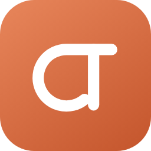
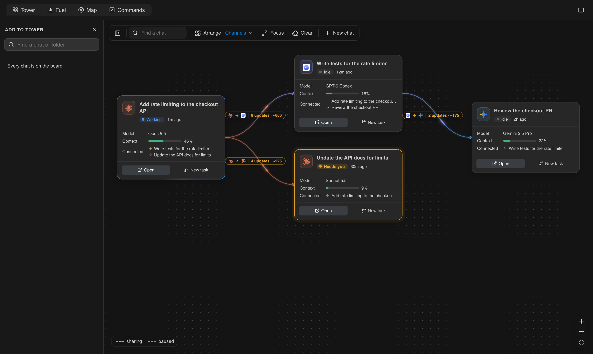
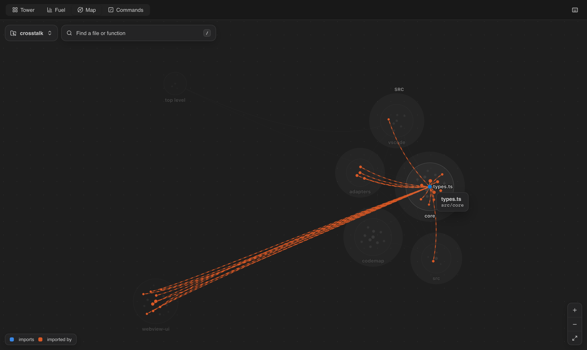
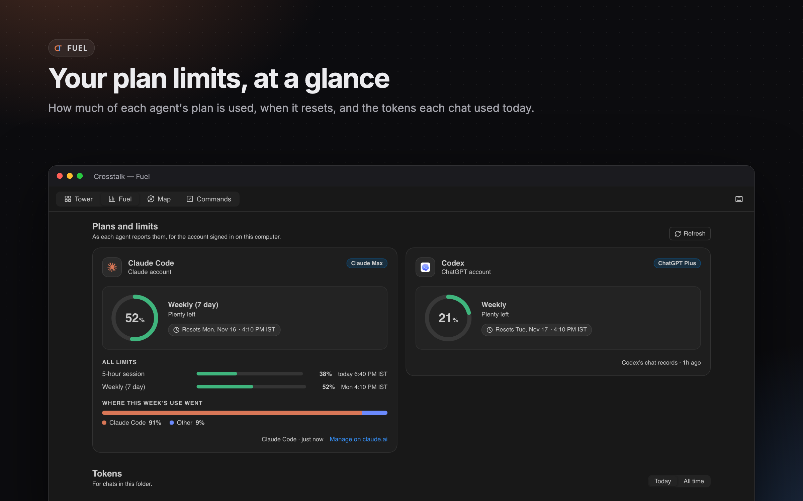
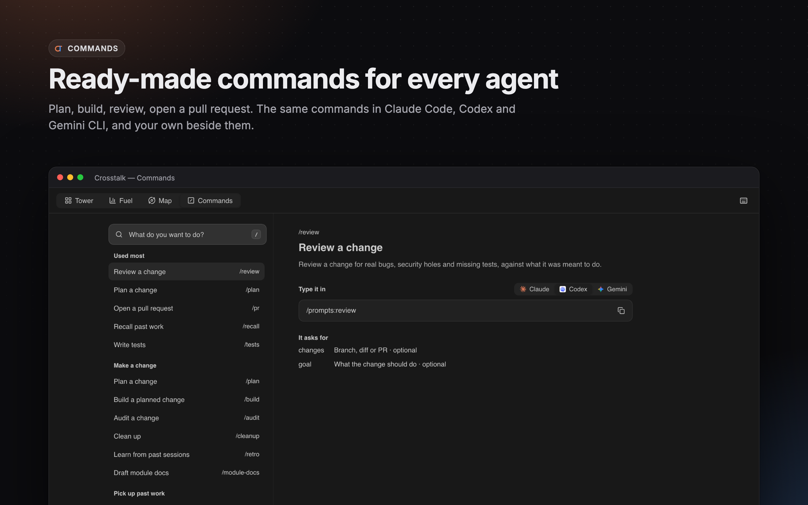
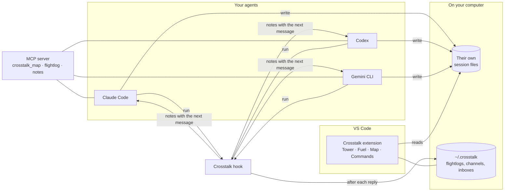

<p align="center">
  
</p>

<h1 align="center">Crosstalk</h1>

<p align="center">
  See every Claude Code, Codex and Gemini CLI chat in one place, and let them share what they did.
</p>

<p align="center">
  <a href="https://github.com/HarshBaldaniya/crosstalk/actions/workflows/test.yml"></a>
  <a href="LICENSE"></a>
</p>

<p align="center">
  VS Code 1.95+ · macOS, Windows, Linux
</p>



## Why

You run several AI coding chats at once: one adds a feature, another writes its tests, a third
reviews the PR. Each one starts blind to what the others just did, so you copy and paste between
them, or explain the same thing three times.

Crosstalk is a VS Code extension that puts all those chats on one board and lets you **connect**
them. When a chat finishes a reply, the chats connected to it get a short note with their next
message: what was asked, what was done, which files changed. It runs no AI of its own; it reads the
session files your agents already keep on your computer.

## What you get

| | |
|---|---|
| **Tower** | Every chat as a card: what it is doing, how full its context is, who it shares with. Drag one card onto another to connect them; click the line to choose how much it sends (**Ping**, **Brief** or **Full**), pause it or close it. |
| **Fuel** | Your plan limits as each agent reports them, when they reset, and the tokens each chat used. |
| **Map** | Your project as a board: each part a small galaxy of its files, built by a parser on your computer. Hover a part to see what it uses and what uses it. TypeScript, JavaScript, Python, Go, Rust, Java, C#, Ruby and PHP. |
| **Commands** | Ready-made commands for all three agents (plan, build, review, PR, tests, recall and more), plus your own. |
| **Agent tools** | Three small tools your agents can call: find code on the Map, read another chat's record, leave notes for the project. |

<table>
  <tr>
    <td></td>
    <td></td>
  </tr>
  <tr>
    <td></td>
    <td></td>
  </tr>
</table>

## How it works



What happens when two chats are connected:


A **flightlog** is a short record of a chat: one line per ask, with what was done, the files, commits
and PRs, and what is still open. It is never a copy of the conversation.

## Install

Crosstalk is not on the Marketplace yet. Install it from source:

```bash
git clone https://github.com/HarshBaldaniya/crosstalk.git
cd crosstalk
npm install
npm run install:vscode     # builds, packages and installs into VS Code
```

Then reload VS Code. You need Node 22 or newer, and at least one of Claude Code, Codex or Gemini CLI.

## Get started

VS Code's welcome page shows **Get started with Crosstalk**, five short steps:

1. **Open the Tower**: the Crosstalk icon in the activity bar, or **Crosstalk: Open the Tower**.
2. **Turn on auto-sharing**: adds Crosstalk's hook to each agent's settings, after a backup. Codex asks
   you to trust a new hook once: type `/hooks` in Codex.
3. **Connect two chats**: drag one card onto another.
4. **Set up my agents**: gives Claude Code, Codex and Gemini CLI the tools and commands below.
5. **See your plan limits**: the plan cards at the bottom of the sidebar open Fuel.

Keyboard: `?` on any page lists its shortcuts. `T`, `U`, `M` and `C` switch between Tower, Fuel,
Map and Commands.

## Agent tools and commands

**Crosstalk: Set up my agents** registers one MCP server with each agent. Its three tools take
under 400 tokens of definitions in every chat:

| Tool | Gives |
|---|---|
| `crosstalk_map` | `find` (ranked code with `path:start-end`), `outline`, `graph` (who uses what), `check` (unused code, stale docs), or an overview of the project |
| `crosstalk_flightlog` | A chat's asks and outcomes; with `query` and no chat, a search of every chat |
| `crosstalk_notes` | Notes chats leave for the project: list, read, save |

Commands are typed as `/crosstalk:review` in Claude Code, `/prompts:review` in Codex and `/review` in
Gemini CLI. Add your own as Markdown files in `~/.crosstalk/library/`.

**Crosstalk: Remove the toolkit from my agents** undoes it.

### From a terminal

The same Map works without VS Code, for CI or cloud agents:

```bash
node ~/.crosstalk/crosstalk.js find "rate limiter"
node ~/.crosstalk/crosstalk.js outline src/api/limits.ts
node ~/.crosstalk/crosstalk.js check docs      # exits 1 when a doc names code that is gone
```

Also `map`, `graph`, `overview`, `check unused`, `commands`, `tokens`, `backup`, `restore` and `mcp`.

## Your data

- **Nothing leaves your computer.** Crosstalk reads your agents' own session files and writes its
  own data to `~/.crosstalk`. It runs no AI model and never reads a login or token file.
- **What it changes, and only when you ask:** auto-sharing adds a hook to each agent's settings;
  **Set up my agents** adds an MCP server and commands. Every file is backed up before it is changed,
  and **Turn off auto-sharing** / **Remove the toolkit** undo them.
- **Where things live:** the Map on each computer (rebuilt in seconds); flightlogs and your commands
  in `~/.crosstalk`, which you can back up to a folder of your choice with the
  `crosstalk.backupFolder` setting; module docs you approve in the repo, under `docs/modules/`.

## Known limits

- Opening a chat in Claude Code's panel uses commands Claude Code does not document. If they change,
  the text is left on the clipboard instead.
- Plan limits for Claude Code come from an experimental API, and each agent reports different ones.
- Codex and Gemini CLI have no hook for "reply finished", so their updates go out once the chat has
  been quiet for a moment.
- Tested on macOS and Linux; Windows runs the test suite in CI.

## Develop

```bash
npm install
npm run build        # dist/
npm run typecheck
npm test             # never touches your real ~/.crosstalk, ~/.claude, ~/.codex or ~/.gemini
```

Press F5 in VS Code (**Run Crosstalk**) to start a window with the extension loaded from source.
See [CONTRIBUTING.md](CONTRIBUTING.md) for how the code is laid out.

## License

[MIT](LICENSE). Crosstalk depends on a few packages under their own licenses, one of them, the Claude
Agent SDK, under Anthropic's terms rather than an open-source license: see
[THIRD_PARTY_NOTICES.md](THIRD_PARTY_NOTICES.md).

Claude, Codex, ChatGPT and Gemini are trademarks of their owners. Crosstalk is an independent project,
not affiliated with or endorsed by them.
